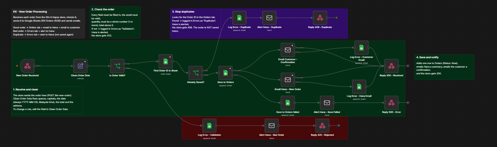
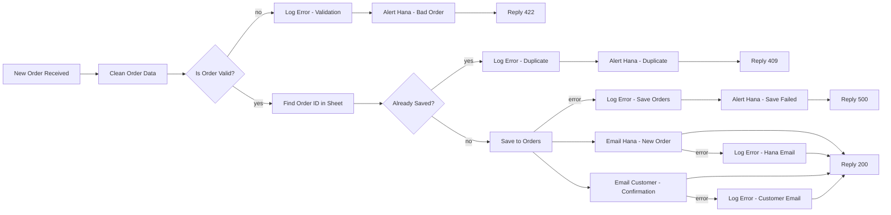

# KK New Order Processing (n8n)

Order automation for a small online shop, built in n8n. Every new order is cleaned, checked against the rules, saved to Google Sheets and confirmed by email, with nobody copying details by hand. Orders that are broken or sent twice go to an Errors tab, and the owner gets an alert.

The shop in this project, Kiln & Kapas, is a demo store that sells handmade ceramics and cotton goods. The customers and orders in the test data are made up.

Status: in progress. The main flow works from start to finish. Failure handling has started: a failed email or a failed save to the Orders tab no longer loses the order. The rest of the failure cases and a few edge cases are next (see [Progress](#progress)).



## What it does

The store sends every new order to an n8n webhook. The workflow then:

1. Cleans the data, so every row in the sheet looks the same.
2. Checks that the order is complete and makes sense.
3. Looks for the Order ID in the sheet, so the same order is never saved twice.
4. Saves the order to the Orders tab with the status "New".
5. Emails the store owner a summary and sends the customer a confirmation.
6. Replies to the store with a status code, so the order form can show the customer the right message.

A rejected or duplicate order is never dropped without a trace. It goes to a separate Errors tab with the original data, and the owner gets an alert email.



## Cleaning rules

Orders come from an old form and a new one, so the same field can arrive in different shapes. The Clean Order Data node fixes them:

- Order ID: every space removed, all capital letters (` kk-10236 ` becomes `KK-10236`).
- Date: always `YYYY-MM-DD` in Malaysia time. It reads ISO dates (`2026-11-08T17:40:00.000Z`), day/month dates with slashes (`07/11/2026 09:05`) and written dates (`8 Nov 2026 2:30 PM`).
- Customer name and product: spaces trimmed and repeated spaces collapsed. Capital letters stay as the customer typed them.
- Email: trimmed, all small letters.
- Total: quantity times price, rounded to 2 decimal places. The price can arrive as a number or as text such as `RM 1,250.00`.
- Shipping address: one line. Line breaks become ", ", and empty lines are skipped.

## Validation

An order is rejected when the Order ID, name, product or address is empty, the email does not look like an email, the quantity is not a whole number of 1 or more, or the total is not above 0.

Broken input, such as a name sent as an object or a quantity of `"two"`, is rejected instead of crashing the workflow.

## When a step fails

Some nodes use n8n's "Continue (using error output)" setting. If one of them fails, the order goes down a separate error path instead of stopping the workflow.

- An email fails (for example, the mail server is down): the order is already saved, so the workflow writes a `Step failure` row to Errors saying which email failed, and still replies 200.
- The save to the Orders tab fails: the order is not in the sheet, so the workflow writes a `Step failure` row to Errors with the whole order, sends the owner an alert with the whole order in it, sends the customer nothing, and replies 500.

## Responses to the store

| Result | Code | Body |
|---|---|---|
| Saved | 200 | `{"status":"received","order_id":"KK-10241"}` |
| Rejected | 422 | `{"status":"rejected","reason":"Order failed the validation check"}` |
| Duplicate | 409 | `{"status":"duplicate","order_id":"KK-10241"}` |
| Could not save | 500 | `{"status":"error"}` |

## Google Sheet

One spreadsheet with two tabs.

Orders: `Order ID`, `Date`, `Customer Name`, `Email`, `Product`, `Quantity`, `Total`, `Shipping Address`, `Status`

Errors: `Timestamp`, `Order ID`, `Error Type`, `Details`, `Raw Data`

`Error Type` is `Validation`, `Duplicate` or `Step failure`. `Raw Data` holds the order exactly as it arrived, as JSON, so it can be fixed by hand.

## Setup

1. Import `workflow/KK-New-Order-Processing.json` into n8n (paste it onto an empty canvas, or use Import from File).
2. Create the two credentials and select them in the nodes:
   - Google Sheets OAuth2, for every Google Sheets node
   - SMTP, for every email node
3. Make a Google Sheet with the two tabs above. In the workflow JSON, the sheet is written as `YOUR_SHEET_ID`. Put your own sheet's link in every Google Sheets node.
4. Change the sender and owner email addresses in the email nodes.
5. Publish the workflow, and point the store's order form at the production URL:
   `POST https://<your-n8n>/webhook/kk-new-order`

Example order body:

```json
{
  "order_id": "KK-10241",
  "order_date": "2026-11-06T02:14:33.000Z",
  "customer_name": "Aisyah Rahman",
  "email": "aisyah.rahman@example.com",
  "product_name": "Speckled Stoneware Mug",
  "quantity": 2,
  "price": 48,
  "shipping_address": "14, Jalan Telawi 3, Bangsar Baru, 59100 Kuala Lumpur",
  "source": "kk-store",
  "currency": "MYR"
}
```

## Changing a field

Each column has its own field in Clean Order Data, and that is the only place its cleaning rule lives. To add a column, add a field there, add the column to the Orders tab, and map it in Save to Orders. If the new field is required, add a condition to Is Order Valid?.

## Progress

Done:

- [x] Webhook that receives orders (test and production URL)
- [x] Data cleaning
- [x] Validation, with rejected orders logged in the Errors tab
- [x] Duplicate check against the sheet, including old orders
- [x] Owner and customer emails, and alert emails
- [x] Status codes back to the store

In progress:

- [x] Keep the order safe when an email fails (mail server down)
- [x] Keep the order safe when the save to the Orders tab fails
- [ ] Keep the order safe when both the Orders and Errors saves fail (the alert email holds the whole order)

Still to do:

- [ ] A separate error workflow that catches crashes
- [ ] Refuse requests without the store's secret header
- [ ] Handle many orders at once without hitting Google Sheets limits
- [ ] Stop a double click from saving the same order twice when both requests arrive together
- [ ] Add a Phone column (a change request from the client)
- [ ] One-page guide for the store owner

## Files

```
README.md
workflow/KK-New-Order-Processing.json
images/workflow.png
```

The exported workflow contains credential names but no passwords or tokens. The Google Sheet ID is replaced with `YOUR_SHEET_ID`.

## Author

Anas Ba Bukair ([AnassSaleh](https://github.com/AnassSaleh))
